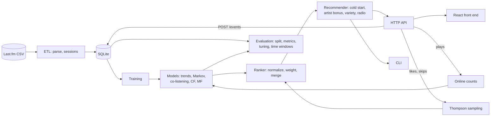

# Music Recommendation System

[](https://github.com/rini1ko/music-rec-sys/actions/workflows/ci.yml)

A hybrid music recommender written in Rust, with a small React front end.
It learns from Last.fm listening history, combines five models with a set of
rules into one ranked list and explains every recommended track. It runs as a
command-line tool and as an HTTP API.

AI was used in making this project

## Features

- **Five models** merged by a weighted ranker: trends, a Markov chain, a
  co-listening graph, user-based collaborative filtering and matrix
  factorization (ALS).
- **Rules on top:** cold start for new listeners, a bonus for the favourite
  artist and at most three tracks per artist.
- **Explanations:** every track shows which models voted for it.
- **Online learning:** a new play updates the next-track and trend models
  without retraining. Likes and skips tune the weights per listener
  (Thompson sampling).
- **Similar tracks and radio** for any track.
- **Evaluation:** hit rate, precision, recall, NDCG, coverage, novelty and
  diversity; weight tuning; backtest on consecutive time windows.
- **Operations:** CSV to SQLite ETL, schema migrations, HTTP API with Swagger
  UI, Prometheus metrics, rate limiting, API key for writes.
- **Front end** (`frontend/`): pick a listener, see recommendations with
  reasons, compare model weights, and a dashboard with charts.

## Installation

You need Rust 1.88 or newer and, for the front end, Node.js 22 or newer.
On Windows the MSVC toolchain also needs Visual Studio Build Tools with the
C++ workload. The first build downloads Swagger UI, so it needs internet.

```bash
git clone https://github.com/rini1ko/music-rec-sys.git
cd music-rec-sys
cargo build --release

cd frontend
npm ci
npm run build
```

## Quick start

```bash
cargo run                                   # demo on data/sample.csv
cargo test                                  # all tests, no network needed
```

**API and front end** (two terminals):

```bash
# terminal 1
cargo run --release -- etl data/sample.csv --db data/demo.db
cargo run --release -- serve --db data/demo.db --lenient

# terminal 2
cd frontend
npm run dev                                 # http://localhost:5173
```

Swagger UI is at <http://127.0.0.1:3000/docs/>. Example request:

```bash
curl "http://127.0.0.1:3000/recommendations?user=1&top=5"
```

On Windows PowerShell use `curl.exe` instead of `curl`.

### Docker

```bash
docker compose up --build
```

The API starts on <http://localhost:3000> and the front end on
<http://localhost:8080>. On the first start the API loads `data/sample.csv`.
For the full dataset see [Run on the full dataset](#run-on-the-full-dataset).
Loading takes several minutes and needs about 6 GB of memory for Docker.

## Data

The project uses the Last.fm listening dataset collected by Òscar Celma, in
the version published on Hugging Face as
[matthewfranglen/lastfm-1k](https://huggingface.co/datasets/matthewfranglen/lastfm-1k).
The full dataset is **not** included in this repository, only a tiny
`data/sample.csv` for the demo and tests.

### Download the full dataset

`scripts/download_dataset.py` downloads the `valid` part from Hugging Face
(1.5M events, 99 users) and saves it as `data/lastfm_valid.csv`:

```bash
pip install huggingface_hub pandas pyarrow
python scripts/download_dataset.py
```

Useful options: `--out PATH` for another file name, `--force` to overwrite an
existing CSV, `--parquet FILE` to convert a `valid.gz.parquet` you already
downloaded by hand. The CSV is large, so it is listed in `.gitignore` and must
not be committed.

### Run on the full dataset

Without Docker, load the CSV into SQLite once and serve that database
(drop `--lenient`, it is only for tiny datasets):

```bash
cargo run --release -- etl data/lastfm_valid.csv --db data/big.db   # a few minutes
cargo run --release -- serve --db data/big.db

cd frontend
npm run dev                                                         # http://localhost:5173
```

With Docker, edit the `api` service in `docker-compose.yml`:

```yaml
services:
  api:
    environment:
      - MUSIC_CSV=data/lastfm_valid.csv   # and no MUSIC_LENIENT
    volumes:
      - ./data:/app/data
```

If the API already started once on the sample, the database lives on a
Docker volume and the CSV is not loaded again. Remove the volume first:

```bash
docker compose down -v
docker compose up --build
```

The first start loads the CSV and trains the models, which takes several
minutes; follow it with `docker compose logs -f api`. The users appear in the
front end only after that. Check the numbers with
`cargo run --release -- stats data/lastfm_valid.csv`: it should report 99 users.

When using this dataset you must reference the Last.fm webpage and cite:

```bibtex
@book{Celma:Springer2010,
    author = {Celma, O.},
    title = {{Music Recommendation and Discovery in the Long Tail}},
    publisher = {Springer},
    year = {2010}
}
```

## Usage

```bash
cargo run -- --help                                          # every command

cargo run --release -- stats data/lastfm_valid.csv
cargo run --release -- recommend data/lastfm_valid.csv --user 123 --top 5
cargo run --release -- eval data/lastfm_valid.csv
cargo run --release -- backtest data/lastfm_valid.csv --windows 4 --days 7

# load into SQLite once, then work on the database
cargo run --release -- etl data/lastfm_valid.csv --db data/big.db
cargo run --release -- serve --db data/big.db
```

| Command | What it does |
|---|---|
| `stats` | users, tracks, events and sessions |
| `recommend --user N` | recommendations for one user with explanations |
| `eval` | every model, the hybrid and the hybrid with rules |
| `tune` | searches for the best model weights |
| `backtest` | every model on consecutive time windows |
| `etl [--append]` | loads a CSV into SQLite |
| `serve` | starts the HTTP API |
| `migrate`, `export`, `bench`, `simulate`, `reset-db` | maintenance and measurements |

### Configuration

`serve` reads settings from the command line, `MUSIC_*` environment variables
and `config.toml`, in that order of priority. Copy `config.example.toml` to
`config.toml` and change what you need (it is in `.gitignore` because it may
hold the API key). `cargo run -- serve --help` lists every option. When the
server has an API key, write requests need the header `x-api-key`.

## Architecture



## Project structure

```
src/
  cli.rs, commands.rs    command-line entry point and commands
  etl/                   CSV loading and session detection
  db/                    repositories, migrations, SQL queries
  models/                trends, Markov, co-listening, CF, MF, bandit
  ranker.rs              merges the candidates of every model
  recommender.rs         ranker plus cold start, artist bonus, radio
  evaluation/            metrics, model comparison, tuning, backtest
  api/                   router, middleware, handlers, OpenAPI
tests/                   integration tests (api, pipeline, cli)
scripts/                 download_dataset.py: fetches the full dataset as CSV
frontend/                React + TypeScript + Tailwind (Vite)
data/sample.csv          small sample for the demo and tests
Dockerfile, docker-compose.yml
.github/workflows/ci.yml fmt, clippy, tests, front-end build, image build
```

## Tests

```bash
cargo test
cargo fmt --all -- --check
cargo clippy --all-targets -- -D warnings

cd frontend
npm run lint
npm run build
```

Unit tests sit next to the code; integration tests in `tests/` use the public
API or the built binary and run on an in-memory SQLite database.

## Results

Evaluated on the `valid` part of the dataset (1.5M events, 99 users). For
every user the newest 20% of their history is held out, and only tracks the
user had not heard before count.

| Model | hit@10 | NDCG@10 |
|---|---|---|
| Trends only | 0.071 | 0.0080 |
| Markov only | 0.101 | 0.0168 |
| Co-listening only | 0.242 | 0.0726 |
| Collaborative filtering only | 0.303 | 0.0555 |
| Hybrid (0.1 / 0.2 / 0.4 / 0.3) | **0.333** | **0.0896** |

The hybrid gives a relevant track in the top 10 to 33% of users and is about
11 times better than the popularity baseline by NDCG. These numbers were
measured before matrix factorization and the rules were added; run
`cargo run --release -- eval --db data/big.db` for the current ones.

**Limitations:** with the per-user split, models can learn from other users'
later listening, so the numbers are slightly optimistic (`--global` gives a
stricter split). Only 99 users are evaluated, so small differences are noise.

## License

No license has been chosen yet, so all rights are reserved by the author
until a `LICENSE` file is added. The Last.fm dataset keeps its own terms of
use.
